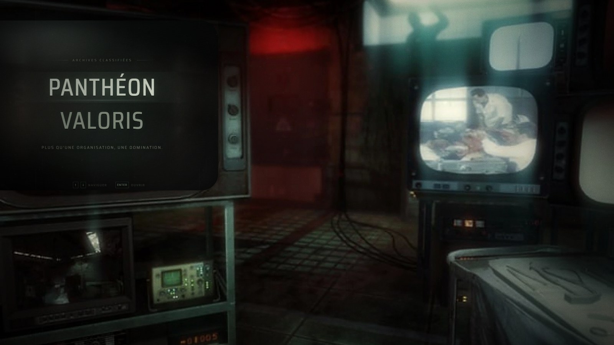
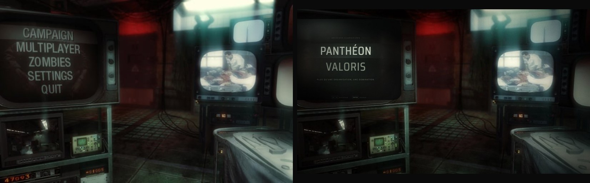
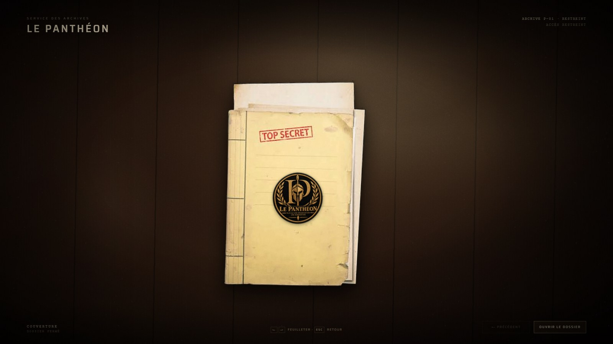
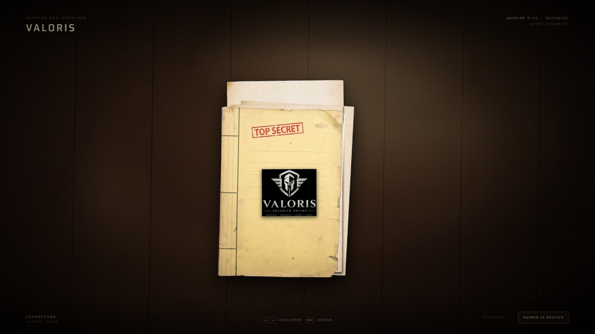
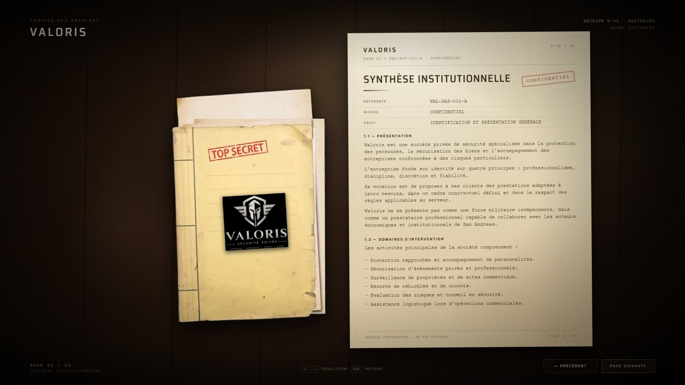

# Le Panthéon / Burger Shot — menu d'archives

Menu interactif dans une salle de surveillance CRT, en **HTML5, CSS3 et JavaScript vanilla (ES6+)**. Aucun framework, aucun build, aucune dépendance runtime.

Le grand téléviseur à gauche ne propose plus que **deux entrées** : **PANTHÉON** et **BURGER SHOT**. Choisir l'une des deux quitte le tube et pose le décor sur une **table d'archives** : un dossier fermé « TOP SECRET » y tombe avec une animation, frappé du sceau de l'organisation choisie. Le dossier s'ouvre ensuite sur des pages consultables avec les **flèches gauche et droite** du clavier.



**Comparaison** — image de référence fournie (gauche) / reconstitution live (droite) :



| Dossier Panthéon | Dossier Burger Shot |
| --- | --- |
|  |  |
|  |  |

> Les deux captures de droite datent de l'ancienne version (dossier Valoris) : le dossier Burger Shot n'a pas encore été re-capturé.

---

## Lancer le projet

Le projet utilise des modules ES6, bloqués en `file://` : il faut un petit serveur local (aucune installation, aucun build).

### Windows — le plus simple

Double-cliquez sur **`serve.bat`**, puis ouvrez <http://localhost:8080/>.

### Toutes plateformes

```bash
cd bo2-menu
python -m http.server 8080
# puis ouvrir http://localhost:8080/
```

ou :

```bash
npx serve .
```

Navigateur conseillé : Chrome, Edge, Firefox ou Safari récent.

---

## Contrôles

| Action | Commande |
| --- | --- |
| Choisir une entrée | `↑` / `↓` (ou `W` / `S`, `Home` / `End`) |
| Ouvrir le dossier sélectionné | `Entrée` ou `Espace` |
| Page suivante / précédente | `→` / `←` (aussi `Page bas` / `Page haut`) |
| Dernière page / couverture | `Fin` / `Début` |
| Fermer le dossier, revenir au menu | `Échap` |
| Souris | survol et clic sur les entrées, les flèches de page et le dossier |

L'interface est entièrement utilisable au clavier. Les dossiers sont aussi accessibles par URL : **`#pantheon`** et **`#burgershot`** (la fermeture ramène à `#main`).

---

## Fonctionnement

### Menu (dans le tube)

- Deux entrées seulement, centrées dans l'écran : **PANTHÉON** et **BURGER SHOT**, avec une description d'une ligne qui change avec la sélection.
- Survol à la souris, déplacement aux flèches, validation à `Entrée` ou au clic.
- Aucun sous-menu, aucune entrée secondaire : le menu ne contient que les deux dossiers.

### Table d'archives

- Fond de table en bois sombre, éclairage chaud, vignettage et grain de pellicule repris de la salle.
- À l'ouverture : fondu de la scène, la table se cale, le dossier **tombe** sur le bureau (translation, légère rotation, ombre portée) puis s'immobilise.
- Le dossier fermé reprend l'image fournie (couverture « TOP SECRET », fond noir détouré) et reçoit le logo de l'organisation : **sceau rond Le Panthéon** ou **logo Burger Shot**.
- Le bouton du pied de page ouvre le dossier ; `Échap` le referme et rend la main au menu.

### Pages du dossier

- **Panthéon** : le dossier complet de présentation de l'organisation, réparti sur **une vingtaine de pages** (22 avec la police de référence : fiche d'identité, présentation, philosophie, façade légale, activités clandestines, objectif stratégique, coup d'État, hiérarchie, recrutement, relations, image, économie, phases RP, engagements, conclusion). Le découpage étant automatique, le nombre exact peut varier de ±1 selon la police système. Chaque section commence sur sa propre page ; les sections longues se poursuivent sur une page « SUITE ».
- **Burger Shot** : le dossier de reprise fourni, en **9 pages** (16 feuilles après découpage automatique) — page de titre (référence `BUR-SHT-001`, classification, candidat, établissement, objet, statut, diffusion, citation et avertissement), **présentation du projet** (1.1 objectifs, 1.2 vision, 1.3 positionnement), **projet à court terme** (2.1 réouverture, 2.2 recrutement, 2.3 offre de lancement, 2.4 communication, objectifs à 30 jours), **projet à moyen terme** (3.1 commercial, 3.2 partenariats, 3.3 animations, 3.4 management, objectifs à 3 mois), **projet à long terme** (4.1 image, 4.2 responsabilités, 4.3 événements, 4.4 expansion, vision à long terme), **organisation et hiérarchie**, **gestion financière**, **engagement personnel**, puis la **conclusion** signée T. McAllister. Chaque section se referme sur sa mention « FIN DE SECTION ».
- Toute page dont le contenu dépasse la hauteur de la feuille est automatiquement découpée en pages de continuation au moment de l'ouverture : le texte ne déborde jamais du papier. Une liste à puces trop longue est coupée à l'item près (deux items minimum sur la suite) au lieu d'être déplacée en bloc, et un intertitre ou une phrase d'introduction terminée par « : » ne reste jamais seul en bas de page.
- Un titre trop long pour tenir sur une ligne est légèrement réduit à la construction des pages, afin que la hauteur de texte reste identique d'une feuille à l'autre.
- Chaque page glisse depuis le dossier et se pose sur la table ; les passages classifiés apparaissent en bandeaux noirs animés.
- En-tête d'organisation, référence d'archive, tampon (`RESTREINT` / `CONFIDENTIEL`), visa et pagination.
- Navigation aux flèches : `→` tourne la page, `←` revient en arrière, la dernière page propose de refermer le dossier. `Échap` sort à tout moment.
- Le compteur, le libellé de section et les boutons se mettent à jour à chaque page ; le changement d'organisation échange le logo et la référence.

### Effets CRT et ambiance

- Lignes de balayage, grain analogique animé, scintillement lent, reflets internes, vignettage du tube.
- Interférences brèves et aléatoires (déplacement d'image, bande de balayage, bruit, souffle audio).
- Écrans de droite (central, haut et bord droit) : **aucun logo ni calque** ajouté par le code — les flux de vidéosurveillance de la photo d'origine restent visibles, avec leur propre éclairage et leurs reflets.
- Petit écran bas gauche : traitement CRT discret ; éclairage rouge et cyan/vert, bloom localisé, micro-rayures.
- **Réduction des animations** : respect de `prefers-reduced-motion` et bascule manuelle persistée ; les boucles Canvas et les interférences sont alors arrêtées.

### Audio

- Entièrement **synthétisé en Web Audio** : bourdonnement 50/60 Hz, souffle filtré, sifflement du tube, clics de sélection, bruissement de page.
- Aucun fichier sonore, aucune ressource externe.
- Démarrage uniquement après un clic ou une touche (règle d'autoplay des navigateurs).

---

## Analyse de la référence et calage visuel

Points mesurés sur l'image fournie (1536 × 961) puis reportés dans la scène 1920 × 1080 :

- Le grand écran CRT occupe le tiers gauche ; le menu est **centré** dans le tube, pas aligné à gauche.
- Hauteur de capitales d'environ 48 px natifs, interligne d'environ 74 px natifs, première ligne à environ 147 px du haut.
- Écran du moniteur central droit : rectangle arrondi d'environ 291 × 220 px natifs (≈ 364 × 277 dans la scène).
- Dominantes : noir/vert profond, rouge sombre au fond, cyan/blanc froid sur les écrans, gris métallique pour les châssis.
- La scène 16:9 est toujours mise à l'échelle pour être entièrement visible, sans déformation. La plaque photographique d'origine (format 1,60:1) est très légèrement recadrée en haut et en bas (environ 6 %) pour remplir le cadre 16:9. Sur les autres formats, des bandes d'ambiance floutées complètent la pièce et un message invite à passer en paysage sur téléphone.

### Décision de production du décor

Le décor photographique est **la capture de référence fournie par le client**, retouchée par `tools/prepare_assets.py` : upscale, légère accentuation, suppression des lettres incrustées dans l'écran gauche par diffusion/inpainting (pour laisser place au menu live), conservation du verre, des reflets et de l'éclairage. Le menu, la table et les dossiers sont reconstruits en DOM/CSS/JS. Les textures (grain, poussière) sont générées procéduralement. Aucun asset du jeu n'est utilisé en dehors de l'image de référence fournie.

---

## Structure

```text
bo2-menu/
├── index.html
├── README.md
├── serve.bat
├── css/
│   ├── main.css            mise en page, scène, chrome global
│   ├── environment.css     habillage des écrans, lumières, halos
│   ├── crt-effects.css     verre, scanlines, scintillement du tube
│   ├── menus.css           typographie et états des deux entrées
│   └── archive.css         table, dossier fermé et pages
├── js/
│   ├── main.js             bootstrap, échelle, réglages, liens #pantheon/#burgershot
│   ├── navigation.js       menu à deux entrées, clavier et souris
│   ├── dossiers.js         données des deux dossiers et de leurs pages
│   ├── dossier.js          table d'archives : couverture, pages, flèches, Échap
│   ├── effects.js          bruit Canvas, interférences, réduction des animations
│   ├── audio.js            synthèse Web Audio (ambiance + interface)
│   └── state.js            réglages persistants
├── assets/
│   ├── images/             décor, dossier détouré et sceaux des dossiers
│   ├── textures/           grain et rayures générés
│   ├── fonts/              Saira variable (OFL) + licence
│   └── reference/          capture de référence fournie
├── docs/                   captures et comparaison
└── tools/
    ├── prepare_assets.py        régénération de la plaque et des textures
    └── prepare_dossier_assets.py détourage du dossier, sceau Panthéon, plaque Valoris
```

Aucune étape de build. Les fichiers sont servis tels quels.

---

## Ressources et licences

| Ressource | Origine | Licence |
| --- | --- | --- |
| `assets/reference/bo2-reference.png` | Capture fournie par le client | Image de référence ; les droits sur l'univers Call of Duty appartiennent à Activision. Usage personnel/éducatif, projet non commercial et non affilié. |
| `assets/images/room-plate.webp` | Dérivée de la capture ci-dessus (retouche, upscale) | Même statut que la référence. |
| `assets/images/dossier-folder.webp` | Photo de dossier fournie par le client, fond noir détouré et agrandie | Visuel fourni par le client. |
| `assets/images/pantheon-seal.png`, `assets/images/burgershot-logo.png` | Logos fournis par le client | Marques des organisations, fournies par le client. |
| `assets/textures/grain-*.png`, `scratches.png` | Générées par `tools/prepare_assets.py` | Libres d'utilisation avec ce projet. |
| `assets/fonts/Saira-Variable.woff2` | Google Fonts / projet Saira | SIL Open Font License 1.1 — voir `assets/fonts/OFL.txt`. |
| Audio | Synthèse Web Audio originale | Aucun fichier audio ; sons générés à l'exécution. |
| Code HTML/CSS/JS | Écrit pour ce projet | Libre d'adaptation pour un usage personnel. |

Ce projet est une **reconstitution de fan**, sans affiliation avec Activision, Treyarch ou Call of Duty.

---

## Vérifications effectuées

Contrôles menés dans Chrome (CDP), captures à l'appui :

- **1920 × 1080**, **1366 × 768**, **1440 × 810**, **1024 × 600** : scène complète et nette, dossiers et pages entièrement visibles, aucun débordement.
- Menu : exactement deux entrées, aucune trace des anciens sous-menus (code, CSS et fichiers supprimés).
- Souris et clavier (`↑` `↓` `Entrée`) ouvrent le bon dossier ; la sélection est conservée au retour du dossier.
- Couvertures : chaque dossier affiche son propre logo et sa référence (`P-01` / `B-02`).
- Moniteurs de droite : plus aucun logo ni calque par-dessus les écrans ; ce sont les flux de la photo d'origine qui sont visibles, avec leur grain et leurs reflets.
- Navigation `→` / `←` sur toutes les pages du dossier Panthéon (22 ici) comme sur les 16 feuilles du dossier Burger Shot (9 pages + suites), jusqu'à « FERMER LE DOSSIER » ; `Début` / `Fin` ; `Échap` rend la main au menu. Réouverture, changement de dossier et retour au même dossier testés (aucun doublon de page, ordre des pages conservé).
- Aucune page ne déborde : contrôle de `scrollHeight` contre `clientHeight` sur toutes les pages des deux dossiers, écart nul, y compris après découpage automatique.
- Liens directs `#pantheon` et `#burgershot` testés au chargement, puis retour à `#main` après fermeture.
- Toutes les images et ressources répondent en HTTP 200, aucune erreur console.
- Aucune image cassée ; les anciens assets de flux vidéo et les fichiers de sous-menus ne sont plus référencés.

### Régénérer les ressources visuelles (optionnel, développement)

```bash
python -m pip install pillow numpy
python tools/prepare_assets.py
python tools/prepare_dossier_assets.py
```

`prepare_assets.py` repart de `assets/reference/bo2-reference.png`. `prepare_dossier_assets.py` est optionnel : les assets finaux sont déjà livrés. Il détoure le fond noir de la photo de dossier, agrandit le visuel et prépare les deux logos à partir des fichiers fournis (chemins à adapter).

---

## Limites assumées

- **Le décor est une plaque photographique retouchée**, pas une pièce 3D temps réel : pas de parallaxe de caméra, pas de déplacement libre dans la salle. La plaque est légèrement recadrée (≈6 % en haut/bas) pour le cadre 16:9.
- **La table est une composition CSS**, pas une scène 3D : l'animation du dossier est une chute/pose (translation, rotation, ombre), pas une simulation physique.
- **Les pages ne se tournent pas en 3D** : elles glissent depuis le dossier et se superposent, avec un fondu ; le rendu reste un dossier posé à plat sur la table.
- **Contenu fictif** : les pages présentent les deux dossiers à partir des éléments fournis (noms, devises, domaines). Aucune information réelle n'est inventée au-delà de la présentation.
- Les **écrans de droite** ne portent volontairement **aucun logo** : ce sont les flux de la plaque photographique d'origine, laissés tels quels. Seul le téléviseur interactif reçoit un calque CRT (bruit Canvas, scanlines, reflets).
- Le **dossier photographié** est fourni en 352 px de large ; il est agrandi 2× et détouré, donc un peu plus doux qu'un visuel natif haute résolution.
- La **police exacte de Black Ops II n'est pas redistribuable** ; la police libre Saira (OFL) a été calée en largeur, hauteur et interligne pour s'en approcher.
- Les **boutons physiques et molettes** visibles sur les téléviseurs font partie de la photo de décor et ne sont pas interactifs.
- Sur un écran non 16:9, la scène est réduite pour rester entière (fit) ; les bandes sont habillées par une version floutée du décor. Aucun téléviseur n'est étiré ni coupé.
- L'audio est une **évocation synthétique** de l'ambiance, pas la bande-son originale.

---

## Remerciements

Merci pour l'image de référence et les visuels des deux dossiers, qui ont servi de base à la composition, aux mesures d'écran et aux dossiers.
